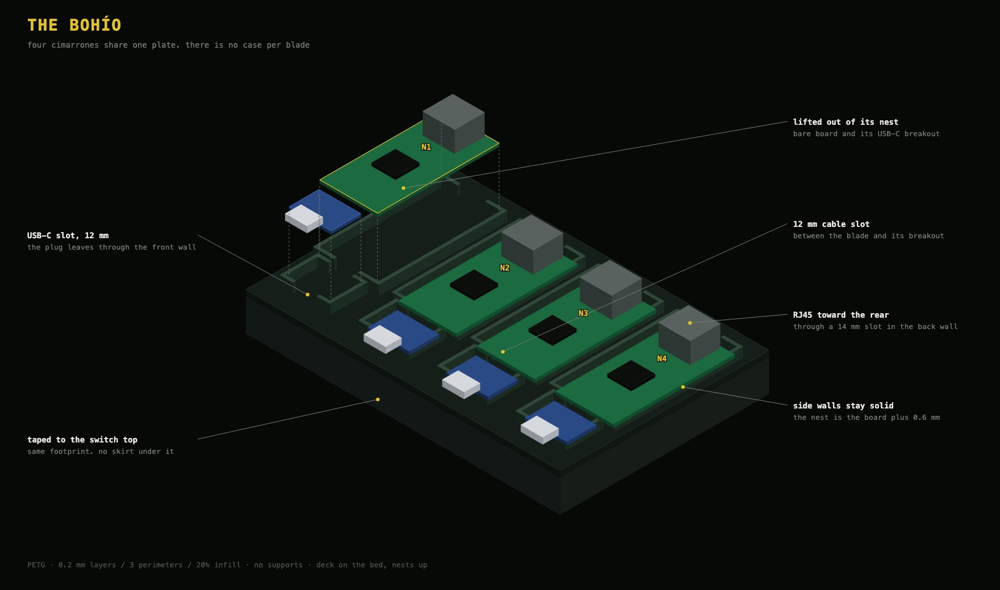

# The bohío

The plate is the bohío. It is one tray on the switch, and the four cimarrones sit in it side by side. There is no case per blade.

The shell around it is the rack. It holds the switch, the GST60A, the fuse board, the bohío, and both screens. Outside 247 × 236 × 102 mm. Later, two 50 mm exhaust fans sit on the outside of the lid and blow out. There is no intake fan.

| Piece | Source | What it is |
|---|---|---|
| Bohío | [`hardware/plate.scad`](../../hardware/plate.scad) | one tray, four nests, one well per USB-C breakout. Same footprint as the switch top |
| Shell | [`hardware/shell.scad`](../../hardware/shell.scad) | the rack: tub, lid, front, and rear |

Print notes and the part names are in the comments at the top of each file, and in [`hardware/README.md`](../../hardware/README.md). The shell meshes are [`shell_bottom.stl`](../../hardware/stl/shell_bottom.stl), [`shell_top.stl`](../../hardware/stl/shell_top.stl), and [`shell_front_back.stl`](../../hardware/stl/shell_front_back.stl). The bohío mesh is [`hardware/stl/plate.stl`](../../hardware/stl/plate.stl). Print the shell as `part` = `tub`, `lid`, and `faces`.

PETG, 0.2 mm layers, 3 perimeters, 20% infill, no supports. The bohío prints deck-down, nests up. The shell floor prints flat.
