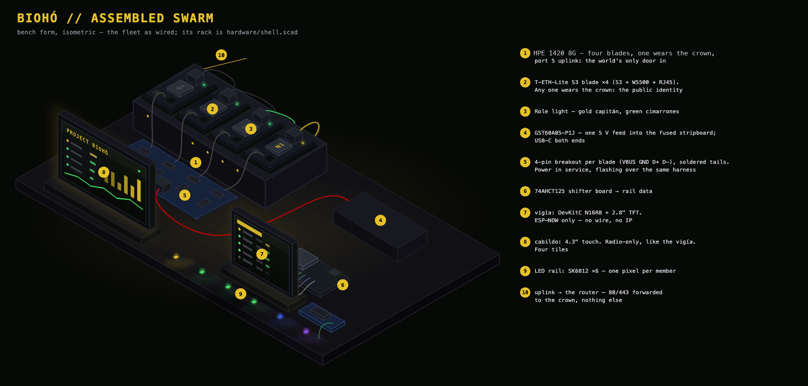

# Hardware build

The build sequence for the whole machine, plus the bench rules that apply
everywhere. The detail lives in the docs beside this one:

| Doc | One line |
|---|---|
| `soldering.md` | raw electronics: blade + display headers, breakout pins |
| `power_circuits.md` | 5 V delivery: the GST60A, the fused USB-C board, first light |
| `data_connectivity.md` | data wiring: which cable carries data where (RJ45 leads, display loom) |
| `led_rail.md` | the LED rail: one pixel per member (strip work, shifter board, hookup in `led/`) |
| `blade_cases.md` | the bohío: one plate for the four cimarrones, inside the shell |

Keep a hardware inventory alongside the build - every board's base MAC, flash size and revision, recorded at intake.

---

## Build Sequence

**What you're building** (bench form; the shell is `hardware/shell.scad`):

**End state:** 4 blades + displays powered, fabric connected, every identity logged - firmware bring-up unblocked.

### Soldering
Full teach-in, per-pin maps, and the meter rituals: `soldering.md`.

1. **Blade headers x6** - 31 joints each, tack-and-square; the full header-strip meter ritual per board before it ever sees power.
2. **Breakout pins x4** - every blade breakout carries the full 4-pin harness (power + data); bond and live checks in the breakout-pins section.
3. **Display headers** - the `display` DevKitC's two strips (~44 joints), meter mini-ritual; real-unit signal map in `soldering.md`, display node headers.
4. Per board: rake-light visual inspection of every joint.

### Blade power + first flash
First light through the feed chain (5.2 V and 3.3 V rails verified), then identity over the blade's own breakout (the intake ritual, `../firmware/intake.md`). Whole-system power map and per-blade procedure: `power_circuits.md`.

Rules that apply at every power-up: the meter check before any first power (continuity feed-to-pin, **no** 5V-GND continuity), and **never two 5 V sources into one board** - GND is shared on purpose.

### Fabric
Per-blade link tests first, switch-side witnessed; then the constellation - four link lights at once. **Port map** on the HPE 1420: `p1-4 = node-1..4`, `p5 = uplink`, `p6-8 = bench/free`. Uplink goes to the **router's LAN port** - the router is the permanent gateway. Full cable map: `data_connectivity.md`, Ethernet plane.

### Display hookup
The TFT's included loom (JST to 13 female Duponts) from Interface 2 onto the display DevKitC per the real-unit map in `soldering.md`, display node headers. **TFT VCC to 3V3**; MISO stays unwired. The white ribbon is the Interface-1 alternative path - unused. The LED rail - one pixel per member, driven by the same DevKitC - is its own build: `led_rail.md`.

### Arrangement
The shell is the rack (`hardware/shell.scad`). The four cimarrones share one bohío, the plate on the switch (`blade_cases.md`, `hardware/plate.scad`).

**Done when:** all link lights on, every MAC in the inventory, boards labelled, a 10-minute powered soak. Then the firmware takes over - elections, the crown, the serving path (`../SYSTEM_DESIGN.md`).

---

## Bench Rules

### On the Bench
Multimeter with continuity beep · laptop + `esptool` + each blade's own 4-pin breakout · sticky labels + fine marker. Iron, solder, and strippers come out only for soldering work.

### Safety + handling
- **ESD:** touch a radiator first, handle PCBs by the edges, no carpet shuffling while boards are out.
- **NEVER DUAL-POWER:** a board on a laptop USB must have its rail lead unplugged first. Muscle memory: *USB in hand, feed out first.*
- **Strapping pins:** never attach signals to ESP32-S3 GPIO **0, 3, 45, 46** - they decide boot behaviour.
- **Mains:** only the sealed GST60A and the switch adapter touch mains. Nothing in this build exposes it.

### Labels + colours
- Wire colours: **red=5V, black=GND, green=LED data, yellow=TFT/SPI, white=I2C/touch, blue=spare**.
- Board labels (sticker + inventory row): `node-1..4`, `spare-1/2`, `display`. Identity before assembly, always.
- Lead labels (tape flags): `n1`-`n4`, `uplink`.
- Mounting standard: the shell is the rack, the plate is the bohío (`hardware/shell.scad`, `hardware/plate.scad`).

### Deliberately out of scope
Out of scope here: firmware (`../firmware/firmware.md` and siblings) · no eFuse burning (assessed, deliberately not burned). Each 5 V port is fused on the stripboard (`power_circuits.md`).

