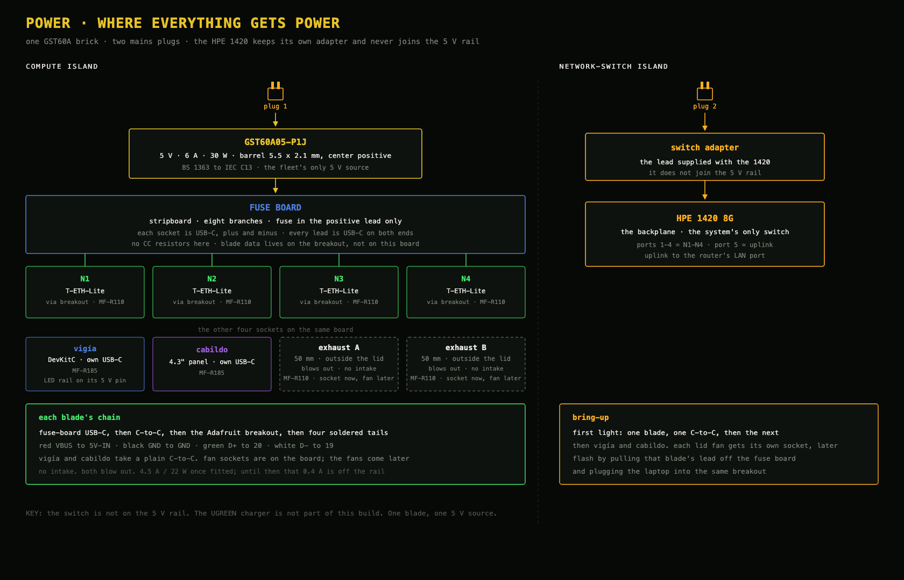

# Power: who gets 5 V, from where, and how

## One-paragraph answer

**One 5 V brick feeds the fleet.** A Mean Well **GST60A05-P1J** (5 V, 6 A, 30 W) plugs into a stripboard. Eight resettable fuses leave that board: six through **USB-C sockets**, two through **2-pin screw terminals** for the lid fans. The HPE OfficeConnect 1420 stays on its own mains lead. Two wall plugs: the brick, and the switch.

The UGREEN Nexode 200 W charger is not part of this build.



---

## Two plugs

| Plug | What it feeds | How |
|---|---|---|
| **Brick** | N1–N4, vigía, cabildo, two lid exhaust fans | GST60A barrel → stripboard → one fuse per branch. Six branches end in a USB-C socket. The two fan branches end in a 2-pin screw terminal |
| **Switch** | HPE 1420 8G only | the adapter supplied with the switch. It does not join the 5 V rail |

The brick’s barrel is 5.5 × 2.1 mm, center positive. The mains cord is separate: BS 1363 to a right-angle IEC C13.

Steady draw, carried over from the earlier ledger: four blades ~0.5 A, two displays ~0.9 A, two lid fans ~0.4 A at their 0.2 A rating, about **4.5 A / 22 W** of the brick’s 6 A / 30 W. The fans are a later step. Until they are fitted, that 0.4 A is not on the rail.

---

## The fuse board

Eight fused branches. Six end in a USB-C socket. Two end in a 2-pin screw terminal.

| Port | Fuse | Lead | Far end |
|---|---|---|---|
| N1–N4 | Bourns MF-R110, 1.1 A hold | C-to-C, 0.5 m | that blade’s USB-C breakout |
| Vigía | Bourns MF-R185, 1.85 A hold | C-to-C, 1 m | the DevKitC’s own USB-C |
| Cabildo | Bourns MF-R185, 1.85 A hold | C-to-C, 1 m | the panel’s own USB-C |
| Exhaust A | MF-R110 | 2-pin screw terminal | one 50 mm fan, on the lid. Not fitted |
| Exhaust B | MF-R110 | 2-pin screw terminal | the other 50 mm fan, on the lid. Not fitted |

MF-R200 stands in for the screen fuses if R185 is out of stock.

Fuses sit in the positive lead only. Cut the copper strip between each fuse’s legs. Each USB-C socket on this board is dumb: solder plus and minus, and leave every other pin empty. Forty-seven joints: 12 on the USB-C ports, 12 holding those ports to the board, 16 on the eight fuses, 3 on the barrel jack, and 4 on the two screw terminals. USB data for a blade lives on the four wires from its breakout to the blade, not on this board.

The sockets do not advertise anything. VBUS is hard 5 V from the brick, the same way a barrel jack is hard 5 V. No CC resistors on the stripboard.

There is no intake fan. The two exhaust fans are ALMOCN 5010, 50 × 50 × 10 mm, 5 V, about 0.08 A each at the nameplate and 0.20 A at the stated maximum. They sit on the outside of the lid and blow out. They are not fitted. Each fan branch is already a fused 2-pin screw terminal, so the leads can land later. The part is [Amazon B0FCC53X7Y](https://www.amazon.de/dp/B0FCC53X7Y), a pack of four; this machine uses two.

---

## Blade harness (each of the 4)

Four wires, soldered. No pin headers between the breakout and the blade.

```
fuse-board USB-C → C-to-C lead → Adafruit downstream breakout
  → four soldered tails:
       red    VBUS → 5V-IN
       black  GND  → GND
       green  D+   → 20 (USB_P)
       white  D−   → 19 (USB_N)
```

The breakout is still required. Its 5.1 kΩ CC resistors are what a USB-C source looks for. CC and SBU holes on the breakout stay empty. On the upright breakouts, D+ and D− are swapped on the silk; follow the labels, and meter every pair before its first plug (VBUS↔GND silent, D+↔D− silent, each data pin silent to VBUS and to GND).

**Flashing a blade** means pulling that blade’s C-to-C off the fuse board and plugging a laptop C-to-C into the same breakout. Same four tails. The laptop is then the only 5 V source. One blade, one source.

The LED rail takes 5 V from the vigía DevKitC’s 5 V pin, not from its own socket.

---

## First light

**Once, before the round:** brick into the barrel socket, mains off until the cold checks pass. Meter in continuity mode.

Per blade, unpowered:

1. **Cold:** breakout VBUS ↔ blade `5V-IN` **beeps** · GND ↔ GND **beeps** · blade `5V-IN` ↔ `GND` **silent**.
2. **Power:** that port’s C-to-C only. **The red LED lights.** Nothing warms.
3. **Spot-read (DC volts):** blade `5V` (pin 16) ↔ `GND` ≈ **4.9–5.25 V** · `3V3` ↔ `GND` ≈ **3.3 V**.
4. **Unplug that C-to-C** before moving to the next blade.

The LED sits on the 3V3 rail at the end of VBUS → ideal-diode Q1 → VCC5V → buck → 3V3, so first light proves the joint, Q1, the buck, and the LED together. Make and break at the USB-C lead, not by desoldering a live tail.

Identity — reading each blade’s MAC over its own breakout — is the intake ritual: [`../firmware/intake.md`](../firmware/intake.md).

---

## Troubleshooting

| Symptom | Cause | Fix |
|---|---|---|
| Blade LED dark | open fuse or a cold joint | meter VBUS at the socket, then at the breakout; re-run first light |
| Powers but no `/dev/cu.usbmodem*` | accessory prompt, D+/D− swapped, or a charge-only lead | approve the prompt; swap the two data tails; confirm IO19/IO20; use a data C-to-C |
| `Failed to connect… no serial data` | not in download mode | hold BOOT, tap RST, release BOOT |
| A port is dead and warm | polyfuse tripped | unplug that lead, let the fuse cool, find the short before plugging it back |
| Two boards warm on one flash | both the rail lead and the laptop are plugged | one C-to-C in the breakout |
